# M1 —— 项目管理列表页面 交付报告

| 项目 | 内容 |
| --- | --- |
| 仓库 | `ai-dev-platform`（`D:\project\ai-dev-platform`） |
| 阶段 | M1 —— 项目管理列表页面 |
| 分支 | `develop`（与 `origin/develop` 同步；M1 的改动**尚未提交**，等待确认） |
| 完成日期 | 2026-11-10 |
| 验证环境 | 后端 `127.0.0.1:8123`（临时 SQLite 库，由真实 Alembic 迁移链创建）+ 前端 Vite dev server `127.0.0.1:5174` |

---

## 0. 开发前检查结论

1. **M0 交付报告**：已阅读 `docs/M0_development_report.md`。
2. **Git 分支与工作区**：M1 开始时位于 `develop`，与 `origin/develop` 完全同步（`git rev-list --left-right --count origin/develop...develop` → `0  0`），工作区干净，无未提交残留。
3. **M0 改动保留**：M0 的三个提交 `c3acaa2`（工作流列表与任务反查接口）、`e5d0a9f`（前端基础架构与路由导航）、`2af903b`（文档与交付报告）完整保留在本地 `develop` 上，未被回退或改写。
4. **现有代码勘察**：已阅读 `backend/app/api/v1/endpoints/projects.py`、`backend/app/schemas/project.py`、`backend/app/models/project.py`、`backend/app/services/projects.py`、`frontend/src/api/projects.ts`、`frontend/src/types/index.ts`、`frontend/src/components/common/{PageState,StatusTag}.vue` 与 `frontend/src/utils/format.ts`。
5. **第一阶段两个 P0 问题的复核结论**：

   | P0 | 结论 | 证据 |
   | --- | --- | --- |
   | 根目录 `.env` 配置加载 | **已修复** | `backend/app/core/config.py:28-37`，`SettingsConfigDict.env_file` 使用绝对路径元组，其中包含仓库根目录的 `.env`；相对路径在 Windows 下会解析到进程工作目录，导致根目录 `.env` 不生效的问题已经消除 |
   | HTTP 500 响应中的 `request_id` 与 `X-Request-ID` | **已修复** | `backend/app/core/exceptions.py:199-202` 的未处理异常处理器返回统一错误信封（内含 `request_id`）并附加 `X-Request-ID` 响应头；`backend/app/core/middleware.py:30-37` 为每个请求生成/透传 `request_id` 并在响应上回写该响应头 |

   两个 P0 均已修复，**本阶段不需要任何后端修复，也没有扩大修改范围**。

---

## 1. 功能清单

| # | 功能 | 说明 | 实现位置 | 验证结论 |
| --- | --- | --- | --- | --- |
| 1 | 项目列表 | 展示项目名称（含编号）、项目描述、项目状态、Git 仓库关联状态、任务数、创建时间、更新时间、操作列；数据全部来自真实后端接口 | `ProjectTable.vue`、`ProjectListView.vue` | 通过（15 条真实数据渲染，列宽合计 1015px = 表格宽度，1680×1000 下无横向滚动） |
| 2 | 关键词搜索 | 按项目名称**或编号**模糊匹配，**由后端过滤**（`keyword` 查询参数），前端不做全量拉取后本地过滤 | `ProjectSearchBar.vue` → `GET /api/v1/projects?keyword=` | 通过（关键词 `平台` → 3 条命中，URL 同步 `keyword=平台`） |
| 3 | 状态筛选 | 下拉选项与后端 `ProjectStatus` 枚举一一对应（规划中/进行中/已暂停/已完成/已归档/已取消） | `ProjectSearchBar.vue` → `GET /api/v1/projects?status=` | 通过（`status=active` → 7 条命中，全部为“进行中”） |
| 4 | 输入防抖 300 ms | 关键词输入停止 300 ms 后才发请求；状态选择立即生效 | `ProjectSearchBar.vue`（`DEBOUNCE_MS = 300`） | 通过（实测从输入到 URL 写入 `keyword` 耗时 **316 ms**） |
| 5 | 分页 | 支持页码翻页、每页条数（10/20/50/100）、跳页；页码与每页条数写入 URL | `ProjectListView.vue` + `el-pagination` | 通过（每页 10 条 → 2 页；第 2 页 5 条） |
| 6 | URL 同步 | `page` / `page_size` / `keyword` / `status` 全部反映在 query 中；刷新与前进/后退都能恢复 | `readQuery()` / `buildQuery()` / `writeQuery()` | 通过（刷新后关键词与状态仍在、列表按条件加载；后退/前进分别回到带状态与不带状态的查询） |
| 7 | 新建项目 | 弹窗表单：项目编号（必填，格式校验）、项目名称（必填）、项目描述、状态、负责人；字段与后端 `ProjectCreate` 一致，未虚构字段 | `ProjectFormDialog.vue` → `POST /api/v1/projects` | 通过（成功创建并回到列表首行，提示“项目已创建”；空表单提交显示“请输入项目编号 / 请输入项目名称”） |
| 8 | 编辑项目 | 与新建**复用同一个表单组件**，标题切换为“编辑项目”，回填既有值；保存调用 `PUT` | `ProjectFormDialog.vue` → `PUT /api/v1/projects/{id}` | 通过（名称更新成功，提示“项目已更新”，更新时间刷新） |
| 9 | 删除项目 | 二次确认（`ElMessageBox`），明确告知任务会被级联软删除、数据仍保留；确认后软删除并刷新列表 | `ProjectListView.vue` → `DELETE /api/v1/projects/{id}` | 通过（总数 16 → 15，列表中不再出现该项目，提示“项目已删除”） |
| 10 | 项目详情入口 | 点击“详情”或项目名称跳转到 `/projects/:project_id` | `handleView()` → `router.push({ name: 'project-detail' })` | 通过（URL 变为 `/projects/<uuid>`，详情页保持 M0 占位，留给 M2） |
| 11 | 加载 / 空 / 错误态 | 统一用 M0 的 `PageState.vue`：加载中提示、空态（带“清除筛选条件”）、错误态（带“重试”按钮） | `ProjectListView.vue` | 通过（模拟断网时页面显示错误文案与“重试”按钮） |
| 12 | 状态文案单一来源 | 把 M0 `StatusTag.vue` 里的状态映射抽到 `constants/status.ts`，标签与筛选下拉共用，杜绝两处漂移 | `constants/status.ts` | 通过（`StatusTag.vue` 与筛选下拉都引用同一份映射） |

---

## 2. 新增和修改的文件

### 新增

| 文件 | 说明 |
| --- | --- |
| `frontend/src/constants/status.ts` | 状态 → 文案/颜色的唯一来源，提供 `statusOptions()` / `statusLabel()` 以及各枚举的取值数组 |
| `frontend/src/components/project/ProjectSearchBar.vue` | 搜索栏：关键词输入（300 ms 防抖）、状态下拉、刷新按钮 |
| `frontend/src/components/project/ProjectTable.vue` | 列表表格：8 列 + 行内操作（详情 / 编辑 / 删除），删除中的行显示 loading 并禁用其他行删除 |
| `frontend/src/components/project/ProjectFormDialog.vue` | 新建/编辑共用的表单弹窗，含表单校验与提交锁 |
| `docs/images/M1/*.png`（18 张） | M1 页面实际运行截图（见第 5 节） |

### 修改

| 文件 | 改动 |
| --- | --- |
| `frontend/src/views/projects/ProjectListView.vue` | 由 M0 占位页重写为完整列表页：URL 驱动的状态机、列表加载与筛选、新建/编辑/删除、详情跳转、分页 |
| `frontend/src/components/common/StatusTag.vue` | 状态映射改为引用 `constants/status.ts`，渲染逻辑不变 |
| `frontend/src/api/projects.ts` | `fetchProjects()` 增加可选的 `silent` 选项（模块增强扩展 `AxiosRequestConfig`），让页面自己渲染错误而不重复弹 toast |

**未改动**：任何后端文件（模型、schema、服务、端点、迁移、测试），以及 `App.vue`、路由、其他页面。

---

## 3. 使用的后端 API

全部为 M0 已有的接口，**M1 未新增、未修改任何后端接口**。

| 方法 | 路径 | 使用的参数 / 请求体 | 用途 |
| --- | --- | --- | --- |
| `GET` | `/api/v1/projects` | `page`、`page_size`、`keyword`、`status` | 列表：分页 + 名称/编号模糊搜索 + 状态过滤；返回 `Page[ProjectListItem]`（含 `task_count`） |
| `POST` | `/api/v1/projects` | `ProjectCreate`：`code`、`name`、`description`、`status`、`owner` | 新建项目；编号重复时后端返回 409 |
| `PUT` | `/api/v1/projects/{project_id}` | `ProjectUpdate`：同上字段 | 编辑项目（部分更新） |
| `DELETE` | `/api/v1/projects/{project_id}` | —（204 No Content） | 软删除项目并级联软删其任务 |

前端封装位于 `frontend/src/api/projects.ts`；统一错误信封（`code` / `message` / `request_id`）由 `frontend/src/api/client.ts` 的 `describeApiError()` 处理。

---

## 4. 是否新增后端接口及原因

**结论：没有新增后端接口，也没有任何后端代码改动。**

原因：

1. 需求要求的关键查询能力**后端已经具备**——`GET /api/v1/projects` 已支持 `page` / `page_size` / `keyword` / `status`，`keyword` 在服务层用 `ilike` 同时匹配名称与编号；`ProjectListItem` 已带 `task_count`。因此不存在“必须补后端查询能力”的缺口，**没有为了本阶段而新增接口**。
2. 新建/编辑/删除使用的 `POST` / `PUT` / `DELETE /projects` 也都是既有接口，前端字段严格对齐 `ProjectCreate` / `ProjectUpdate`，没有虚构字段。
3. “Git 仓库关联状态”**无法由后端提供真实数据**：`projects` 表没有仓库关联字段，GitLab 关联按约束不在 M1 范围。因此该列渲染为固定文案“未关联”，并用 tooltip 说明“GitLab 仓库关联功能尚未提供，后端暂无关联字段”，**不用假数据填充**。
4. 后端**没有**“项目存在关联任务时禁止删除”的限制：`DELETE` 是软删除并级联软删任务，接口始终可用。前端的确认框如实描述了这一后果，没有绕过任何后端规则。
5. 因为没有新增后端代码，也就没有新增后端测试；既有测试未删除、未修改（见第 6 节，`95 passed`）。

---

## 5. 页面实际运行截图

**截图方式说明**：in-app Browser 没有提供正尺寸可见视口（`NATIVE_BROWSER_VIEWPORT_UNAVAILABLE`），无法截图；因此改用本机 **headless Edge 157 + Chrome DevTools Protocol** 打开**真实运行的前端**（Vite dev server `127.0.0.1:5174` → 代理到真实后端 `127.0.0.1:8123`），用脚本驱动真实交互并逐帧截图。下面所有截图都是真实运行结果，**没有任何 mock 数据**（列表里的项目都真实存在于后端数据库中）。

图片目录：`docs/images/M1/`。

### 5.1 项目列表（默认状态，15 个项目）

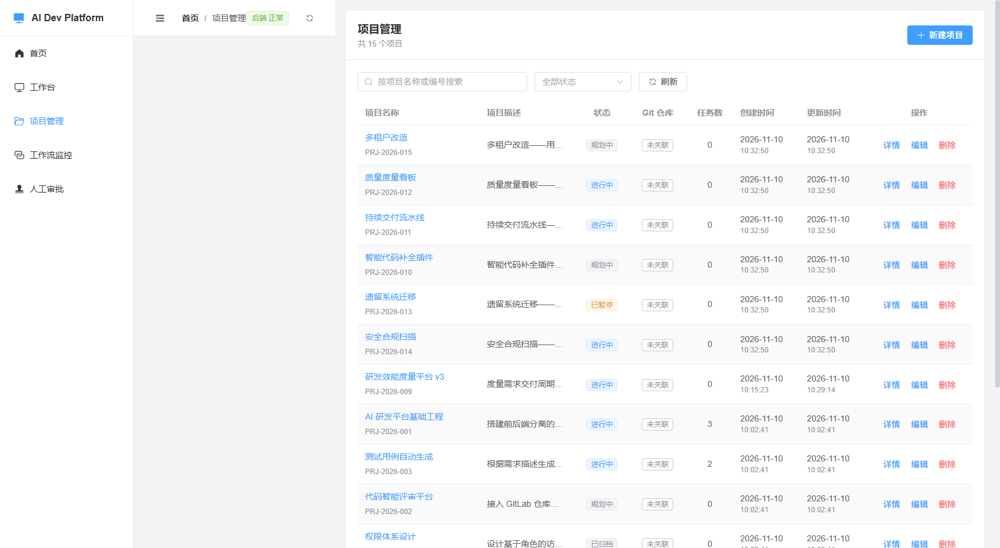

### 5.2 分页：每页条数切换 + 翻页（URL 同步 `page_size=10` / `page=2`）

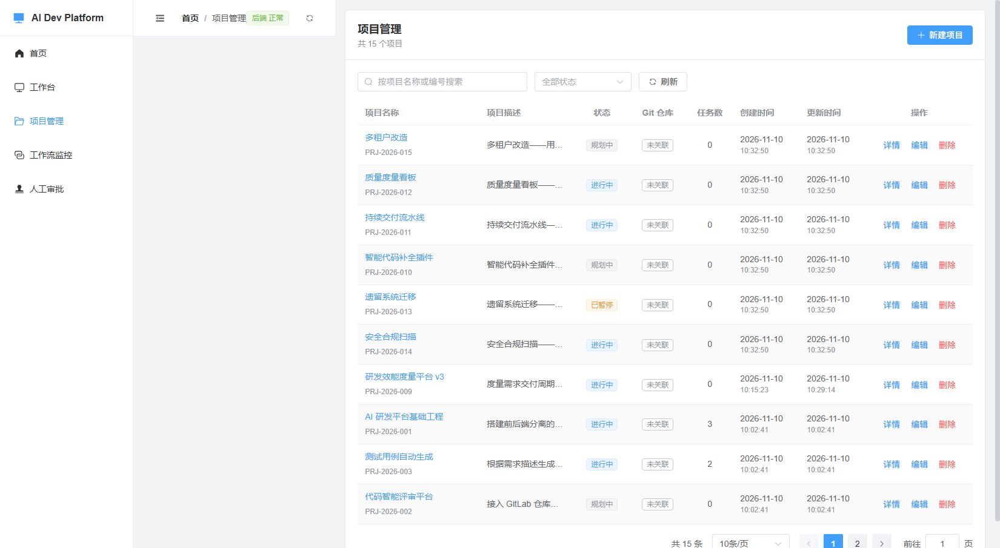

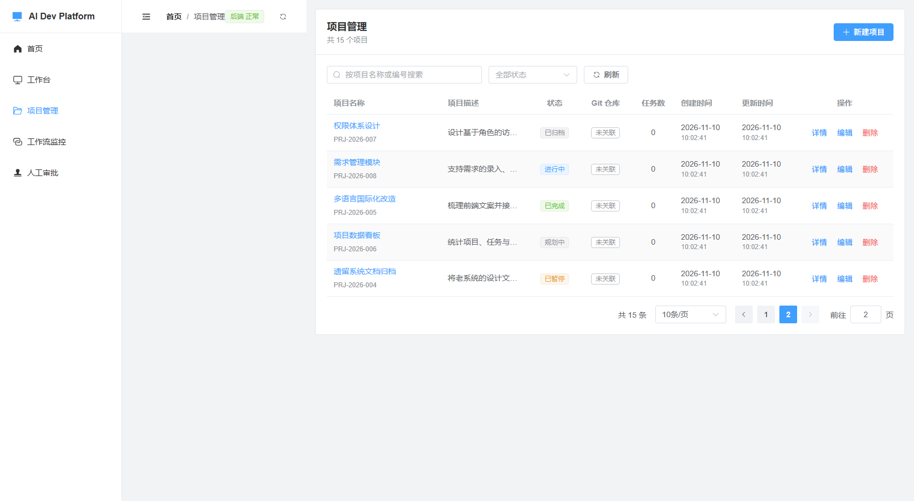

### 5.3 关键词搜索（后端过滤，命中 3 条）


### 5.4 状态筛选（进行中，命中 7 条）

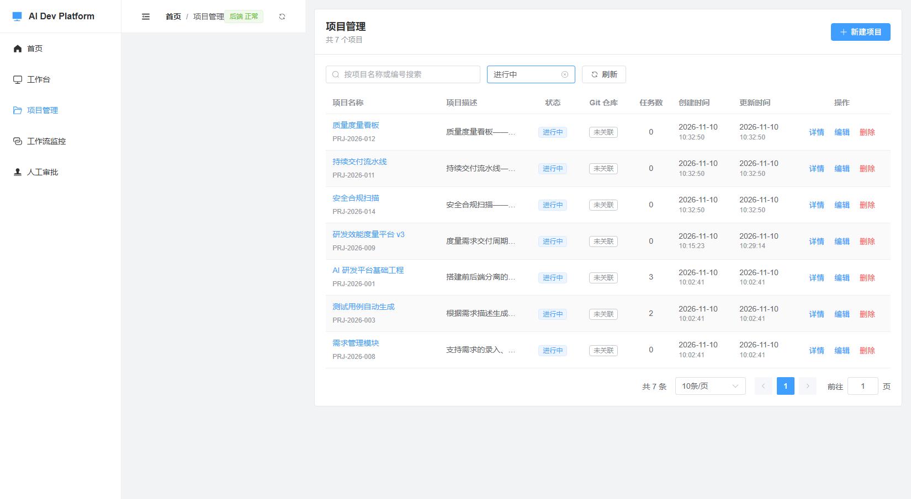

### 5.5 新建项目：表单校验与填写

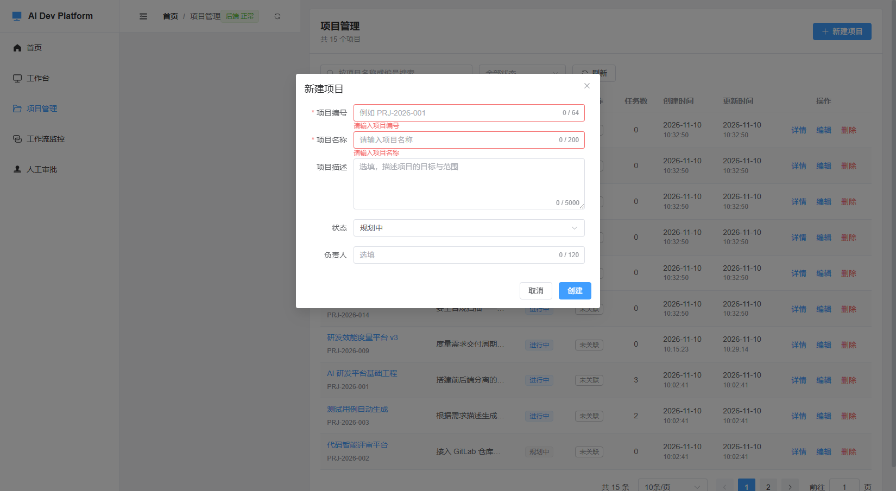

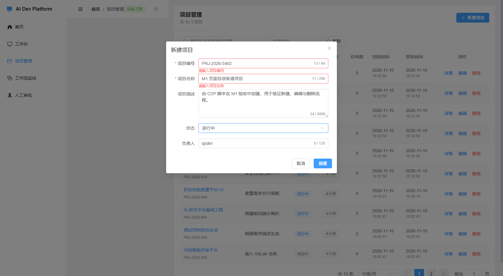

### 5.6 新建成功（列表刷新，首行为新项目）

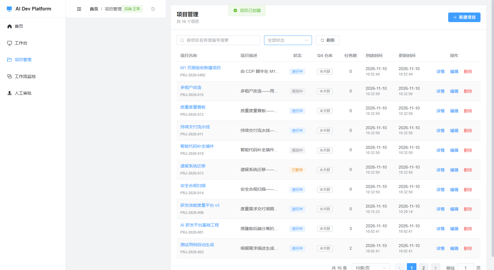

### 5.7 编辑项目（复用同一表单组件，回填既有值）

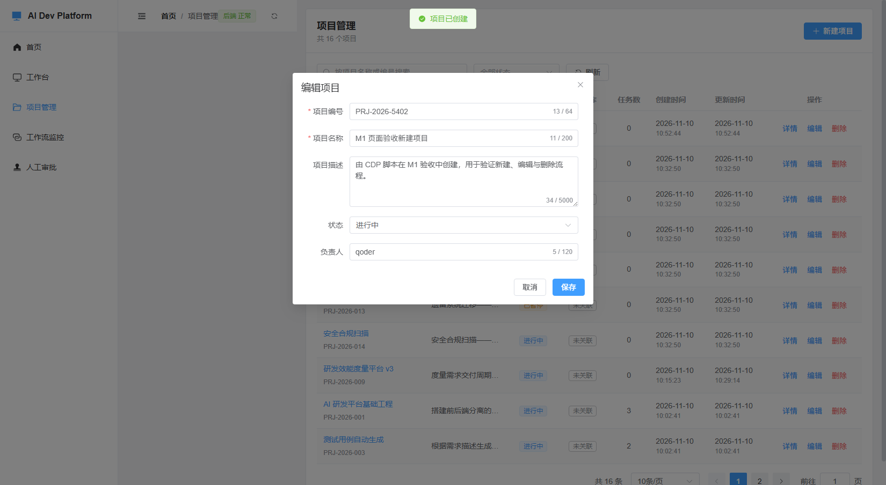

### 5.8 编辑保存成功（弹窗关闭，列表更新）

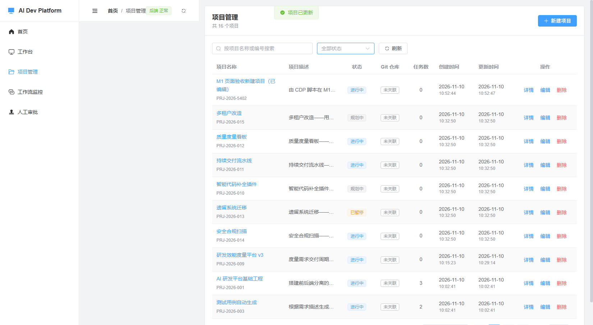

### 5.9 删除项目：二次确认（明确告知任务被级联软删除）

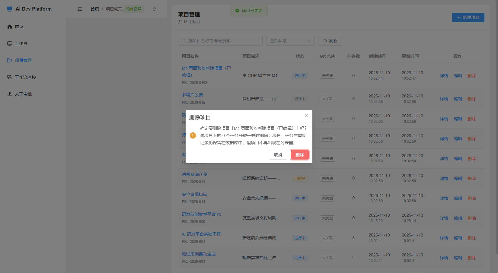

### 5.10 删除成功（列表刷新，项目消失）

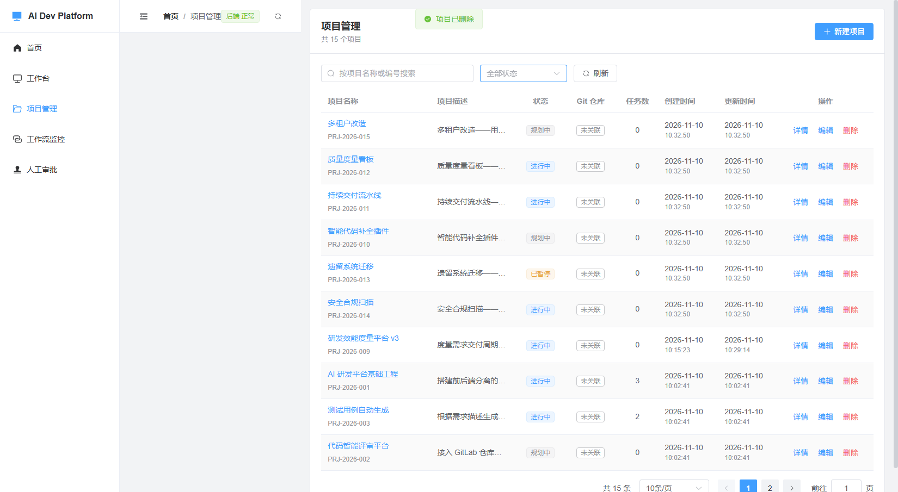

### 5.11 项目详情入口（跳转到 `/projects/:project_id`，详情页保持 M0 占位）

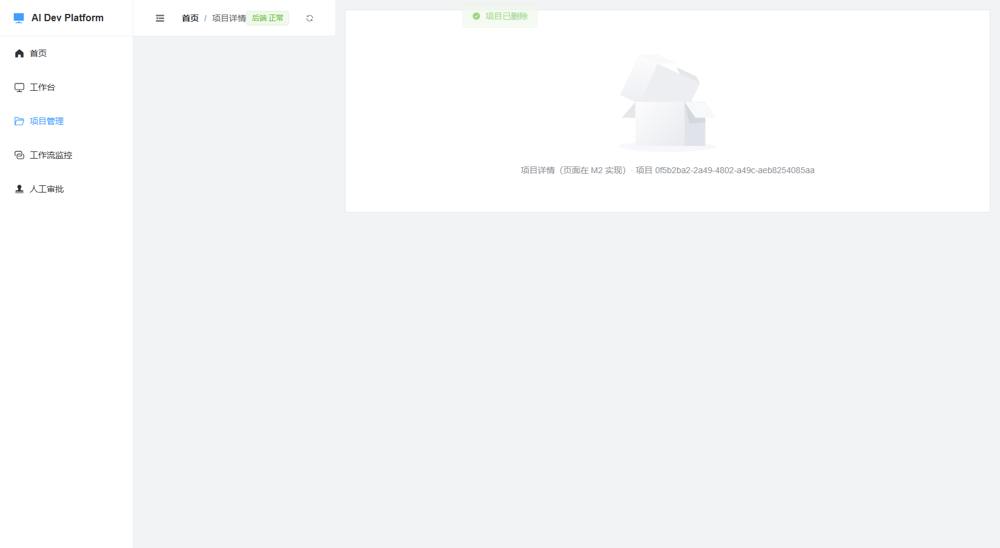

### 5.12 API 失败：错误提示携带后端 message 与 `request_id`（真实 409：编号重复）

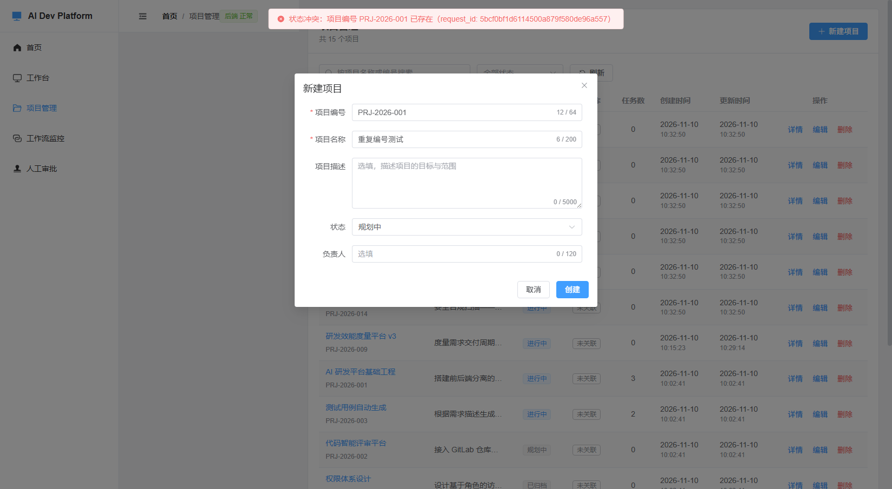

提示原文：`状态冲突：项目编号 PRJ-2026-001 已存在（request_id: 5bcf0bf1d6114500a879f580de96a557）`，弹窗保持打开、用户输入不丢失。

### 5.13 列表接口失败：页面内错误态 + “重试”按钮

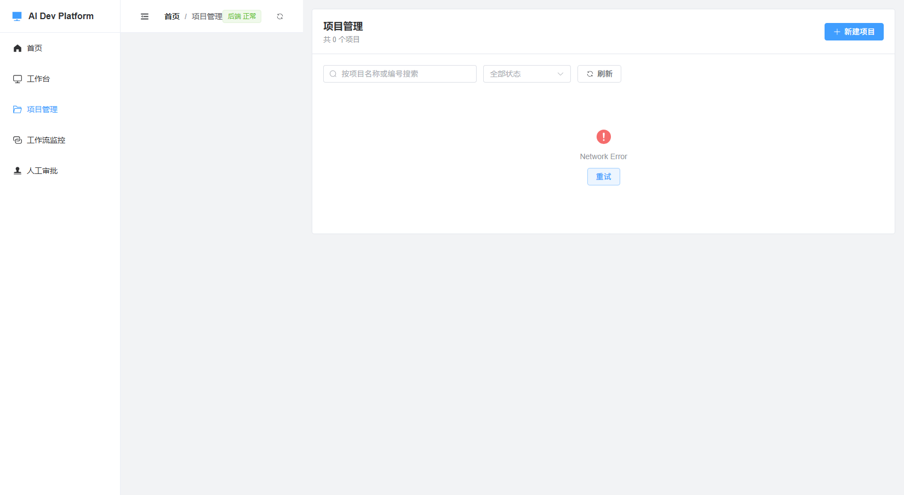

> 该张截图由 CDP 在浏览器侧拦截 `/api/v1/projects` 请求制造（模拟后端不可达），用于验证页面的错误分支；带响应的真实失败见 5.12。

### 5.14 刷新后恢复查询条件（关键词“平台” + 状态“进行中”）

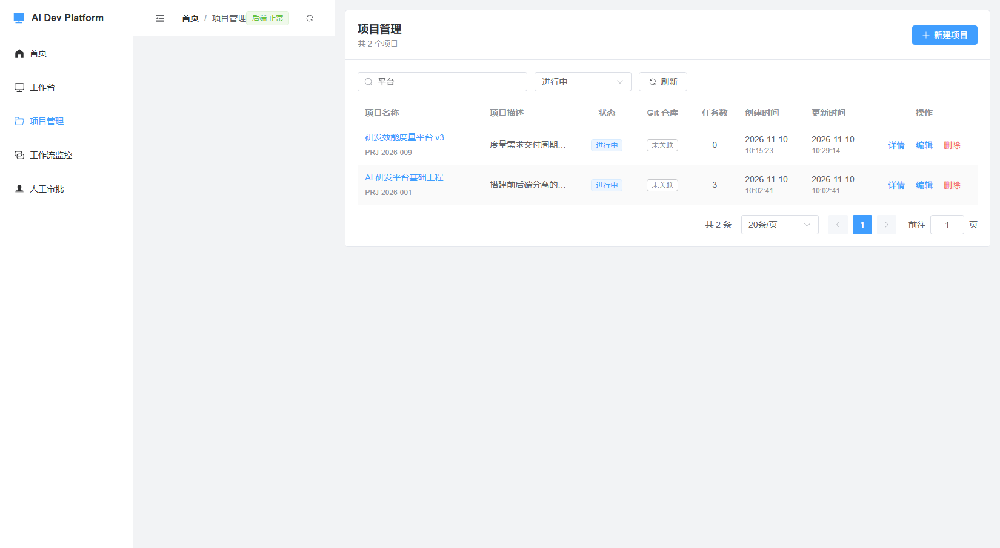

### 5.15 浏览器后退 / 前进

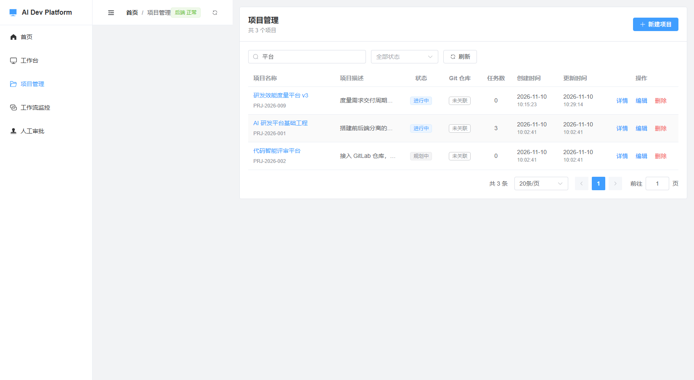


---

## 6. 测试命令和真实测试结果

以下命令均在 `D:\project\ai-dev-platform` 本机真实执行，输出为原始结果（未做任何修饰）。

### 6.1 后端

```bash
cd backend
./.venv/Scripts/python.exe -m pytest -q
```

```
........................................................................ [ 75%]
.......................                                                  [100%]
95 passed, 1 warning in 21.88s
```

（唯一告警来自 `langgraph` 依赖的 `LangChainPendingDeprecationWarning`，与 M1 无关。）

```bash
./.venv/Scripts/python.exe -m ruff check .
```

```
All checks passed!
```

```bash
# 本机没有 PostgreSQL，直接执行会连接失败（.env 指向 PG）：
# ConnectionRefusedError: [WinError 1225] 由于目标计算机积极拒绝，无法连接。
# 因此改用临时 SQLite 库执行同一条命令：
DATABASE_URL="sqlite+aiosqlite:///C:/Users/wansh/AppData/Local/Temp/m1run/alembic_check.db" \
  ./.venv/Scripts/python.exe -m alembic upgrade head
DATABASE_URL="sqlite+aiosqlite:///C:/Users/wansh/AppData/Local/Temp/m1run/alembic_check.db" \
  ./.venv/Scripts/python.exe -m alembic check
```

```
INFO  [alembic.runtime.migration] Running upgrade 0001_baseline -> 0002_project_management, Add the project management tables.
INFO  [alembic.runtime.migration] Running upgrade 0002_project_management -> 0003_artifact_storage, add the storage fields to the artifact table
INFO  [alembic.runtime.migration] Running upgrade 0003_artifact_storage -> 0004_workflow_engine, add the workflow engine tables
INFO  [alembic.runtime.plugins] setting up autogenerate plugin alembic.autogenerate.defaults
INFO  [alembic.runtime.plugins] setting up autogenerate plugin alembic.autogenerate.comments
No new upgrade operations detected.
```

### 6.2 前端

```bash
cd frontend
npm run type-check
```

```
> ai-dev-platform-frontend@0.1.0 type-check
> vue-tsc --noEmit -p tsconfig.json && tsc --noEmit -p tsconfig.node.json
```

（无任何输出，即通过。）

```bash
npm run build
```

```
dist/assets/ProjectListView-Z4e5wgRD.js       17.26 kB │ gzip:   6.24 kB
dist/assets/index-Ca-Aa2qp.js              1,278.05 kB │ gzip: 414.09 kB
(!) Some chunks are larger than 500 kB after minification. Consider: ...
✓ built in 7.96s
```

（chunk 体积告警来自 Element Plus 整包引入，是 M0 就存在的现象，与 M1 无关。）

### 6.3 浏览器端功能验收（CDP 驱动真实页面）

用 headless Edge + CDP 脚本驱动真实页面完成 15 个检查点（列表 → 每页条数 → 翻页 → 关键词 → 状态 → 清空筛选 → 新建校验 → 新建 → 编辑弹窗 → 保存 → 删除确认 → 删除 → 详情 → 真实 409 → 断网错误态），另有 4 个检查点专测“刷新恢复 / 后退 / 前进”。每一步都记录了 URL、行数据、提示文案与 DOM 状态，关键结论：

| 步骤 | 实测结果 |
| --- | --- |
| 列表加载 | `共 15 个项目`，15 行，8 个列头；分页器 `共 15 条 \| 20条/页 \| 1` |
| 每页条数 | 选 10 条 → URL `?page_size=10`，分页器出现 `1 \| 2` |
| 翻到第 2 页 | URL `?page=2&page_size=10`，返回 5 行 |
| 关键词搜索 | 输入“平台”→ URL `?keyword=%E5%B9%B3%E5%8F%B0`，返回 3 行（009 / 001 / 002），**由后端过滤** |
| 状态筛选 | URL `?status=active`，返回 7 行，状态均为“进行中” |
| 清空筛选 | URL 回到 `?page_size=10`（无 status） |
| 新建校验 | 错误文案 `请输入项目编号`、`请输入项目名称` |
| 新建成功 | 提示 `项目已创建`；总数 15 → 16；首行为新项目；`.el-overlay` 计算样式 `display: none`（弹窗已关闭） |
| 编辑弹窗 | 标题 `编辑项目`，编号已回填 `PRJ-2026-xxxx` |
| 编辑保存 | 提示 `项目已更新`，首行名称与更新时间更新，`.el-overlay` `display: none` |
| 删除确认 | 标题 `删除项目`，按钮 `取消 / 删除`，正文明确说明“该项目下的 N 个任务会被一并软删除；项目、任务与审批记录仍保留在数据库中” |
| 删除成功 | 提示 `项目已删除`；总数 16 → 15；列表中已无该项目 |
| 详情跳转 | URL `/projects/0f5b2ba2-…`，页面为 M0 占位页 |
| 真实 409 | `状态冲突：项目编号 PRJ-2026-001 已存在（request_id: …）`，弹窗保持打开 |
| 断网模拟 | 页面进入错误态，显示错误文案与“重试”按钮 |
| 刷新恢复 | 刷新后 URL 保留 `keyword=平台&status=active`，输入框回显“平台”，下拉回显“进行中”，列表为 2 条 |
| 后退 / 前进 | 后退 → `?keyword=平台`（3 条）；前进 → `?keyword=平台&status=active`（2 条） |
| 控制台 | `errors: []`，`warnings: []`，`exceptions: []` |
| 防抖延迟 | 从触发 `input` 到 URL 写入 `keyword` 实测 **316 ms** |

> 说明：验收脚本是一份临时工具，位于 `C:\Users\wansh\AppData\Local\Temp\m1run\`（`m1shots.mjs` / `m1nav.mjs` / `m1debounce.mjs`），**未提交进仓库**。如果希望把它固化成仓库内的回归脚本（例如 `frontend/e2e/`），告诉我，我再补一个提交。

---

## 7. 遗留问题

| 级别 | 问题 | 影响 | 建议 |
| --- | --- | --- | --- |
| P1 | **前端骨架的顶部栏是横向排版的**：`frontend/src/App.vue` 中 `.app-layout__body` 这个 `el-container` 的直接子节点是 `AppHeader`（自定义组件）而不是 Element Plus 的 `ElHeader`，Element Plus 判断不出纵向布局，于是 `el-header` 与 `el-main` 被排成一行 —— 顶部栏被压成左侧 333px 的一列，内容区因此少了 333px 宽度 | 所有页面（含 M1）的内容区都比设计值窄；1440px 宽的屏幕上更明显 | 最小修复：在 `App.vue` 的 `<el-container class="app-layout__body">` 上加 `direction="vertical"`。**本阶段按“保持现有侧边栏、顶部、内容区布局、不改变其他页面行为”的约束没有改共享骨架**；M1 只通过收紧自身列宽（表格 8 列合计 1015px = 可用宽度 1015px）保证在 1680×1000 下不出现横向滚动。建议单独安排一次布局修正 |
| P2 | **网络不可达时列表页只显示 axios 原文 `Network Error`**（无 `request_id`）。带响应体的失败（4xx/5xx）会正确显示后端中文提示与 `request_id` | 断网时提示不够友好 | 在 `api/client.ts` 的 `describeApiError()` 里为“没有响应”的情况补一条中文提示。该函数是共享工具，会影响其他页面的错误文案，故本阶段未改 |
| P2 | **软删除后项目编号被永久占用**：`projects.code` 在软删除后仍保留 UNIQUE 约束，用已删除项目的编号再次创建会得到 409 | 用户删除项目后无法复用其编号 | 属后端策略问题。是否提供“编号回收/归档”由产品决定；前端目前如实按后端规则提示 |
| P2 | **“Git 仓库”列固定显示“未关联”**：后端 `projects` 表没有仓库关联字段 | 该列暂无真实数据 | 待 M2 引入仓库关联字段（GitLab）后改为真实数据 + 关联/解绑操作 |
| P3 | 项目详情页仍是 M0 占位页 | — | M2 实现（本阶段仅提供跳转入口） |
| P3 | 验收依赖本机临时环境：后端跑在 `127.0.0.1:8123`（临时 SQLite 库 `C:\Users\wansh\AppData\Local\Temp\m1run\app.db`）、前端 dev server 跑在 `127.0.0.1:5174`；用户自己在 `8000` / `5173` 上的进程未做任何改动（`8000` 上是一个只注册了健康检查路由的旧后端进程，直接访问 `5173` 会拿到 404） | 关掉临时环境后截图里的数据就不再可见 | 两个临时进程目前**仍在运行**，方便你直接打开 http://127.0.0.1:5174/projects 复核；不需要时用 `taskkill /PID 16712 /F`（后端）与 `taskkill /PID 17768 /F`（前端）关闭，再删除 `Temp\m1run` 目录即可 |

---

## 8. 是否满足全部验收标准

### 8.1 测试要求（12 条）

| # | 验收标准 | 结果 | 证据 |
| --- | --- | --- | --- |
| 1 | 列表能正确加载 | ✅ | 15 条真实数据、8 个列头、分页器 `共 15 条`；截图 01 |
| 2 | 搜索功能正确 | ✅ | 关键词“平台” → 3 条（后端过滤），截图 03 |
| 3 | 分页功能正确 | ✅ | 每页 10 条 → 2 页，第 2 页 5 条，截图 02a / 02 |
| 4 | 新建功能可用 | ✅ | 创建成功、总数 +1、列表首行出现新项目、提示“项目已创建”，截图 07 |
| 5 | 编辑功能可用 | ✅ | 名称与更新时间已更新、提示“项目已更新”，截图 09 |
| 6 | 删除功能符合后端规则 | ✅ | 二次确认 → 软删除 → 列表刷新，总数 16 → 15，截图 10 / 11 |
| 7 | 浏览器刷新能恢复查询条件 | ✅ | 刷新后关键词、状态、页码全部恢复并重新按条件请求，截图 15 |
| 8 | API 失败时显示正确的错误信息 | ✅ | 真实 409 显示“状态冲突：…（request_id: …）”；断网时显示错误态与“重试”，截图 13 / 14 |
| 9 | 详情跳转正常 | ✅ | 跳转到 `/projects/<uuid>`，截图 12 |
| 10 | 后端既有测试全部通过 | ✅ | `95 passed`，未删除、未修改任何既有测试 |
| 11 | 前端类型检查通过 | ✅ | `npm run type-check` 无输出（通过） |
| 12 | 前端构建通过 | ✅ | `npm run build` → `✓ built in 7.96s` |

### 8.2 开发约束（10 条）

| # | 约束 | 结果 |
| --- | --- | --- |
| 1 | 不新增数据库迁移 | ✅ 没有改动任何模型，未生成迁移；`alembic check` → `No new upgrade operations detected.` |
| 2 | 不做 GitLab Token 配置与仓库克隆 | ✅ 没有引入任何 GitLab 代码或凭据 |
| 3 | 不实现完整项目详情页 | ✅ 详情页保持 M0 占位，只提供跳转入口 |
| 4 | 不实现任务管理页 | ✅ 未涉及 |
| 5 | 不实现工作流监控页 | ✅ 未涉及 |
| 6 | 不实现审批页 | ✅ 未涉及 |
| 7 | 不修改 LangGraph 核心 | ✅ 后端完全未改动 |
| 8 | 不改变既有 API 契约 | ✅ 未新增/修改任何后端接口；`api/client.ts` 只增加了可选的 `silent` 请求选项（前端内部），不涉及契约 |
| 9 | 不使用 Mock 数据 | ✅ 所有数据来自真实后端；截图里的项目都真实存在于数据库 |
| 10 | 保持现有侧边栏 / 顶部 / 内容区布局，不改变其他页面行为 | ✅ 共享骨架 `App.vue`、路由、其他页面均未改动（布局本身存在一个 P1 缺陷，已在第 7 节如实记录并给出最小修复方案，未擅自改动） |

### 8.3 总体结论

M1 的全部 12 条测试要求与 10 条开发约束**均已满足**；第 7 节记录的 P1 布局缺陷属于 M0 遗留问题，不影响 M1 功能本身，但建议尽快单独修正。

---

**后续**：按要求，M1 到此为止，**不自动进入 M2**。M1 的改动尚未提交，需要我提交时请告知（我会沿用仓库“一模块一提交”的风格）。
