# M2 —— 项目详情页 交付报告

> 日期：2026-11-10
> 范围：任务 5 的 M2 阶段——`/projects/:project_id` 项目详情页（基本信息、任务列表与新建、工作流概览、GitLab 占位），以及 M2–M4 共用的前端基础设施。
> 前置：M0（类型 / API 封装 / 公共组件 / 路由）、M1（项目列表页）已完成；M1 改动尚未提交。

## 0. 开发前检查结论

- 已通读 `docs/task5_task6_api_inventory.md`、`docs/task5_task6_implementation_plan.md`、`docs/M0_development_report.md`、`docs/M1_project_management_report.md`，并逐一核对了 `backend/app/api/v1/endpoints/*.py` 中的真实路由与 `app/schemas/*.py` 的字段。
- M2 需要的数据全部已有接口：`GET /projects/{id}`、`PUT /projects/{id}`、`GET /projects/{id}/tasks`、`POST /tasks`、`PUT /tasks/{id}`、`GET /workflows?project_id=`。
- **本阶段未新增任何后端接口，未新增数据库迁移，未改动既有 API 契约。**
- `WorkflowRead` 只有 `project_id` / `task_id`，没有名称。按“不改既有响应结构”的约束，名称由前端解析：任务页已加载的任务直接复用，其余 id 经 `useReferenceStore` 缓存后逐个查询（每个 id 只查一次，轮询不重复）。
- 既有工作流为 LangGraph **模拟**流程，页面上的类型标签写作「研发工作流（模拟）」，不描述为接入真实模型。

## 1. 功能清单

| 需求 | 实现 | 状态 |
| --- | --- | --- |
| 基本信息：编号 / 名称 / 描述 / 状态 / 负责人 / 创建 / 更新时间 | `el-descriptions` 三列布局，状态复用 `StatusTag` | 完成 |
| 编辑项目，复用 M1 表单 | `ProjectFormDialog` 的 `project` 属性放宽为 `ProjectRead`，提交 `PUT /projects/{id}` 后以返回值刷新页面 | 完成 |
| 项目不存在 / 已软删除 / 接口失败 | 404 → “该项目不存在或已被删除”+「返回项目列表」；其他失败 → 后端 message + `request_id` +「重试」 | 完成 |
| 任务列表（分页 + 状态筛选），列：名称 / 描述 / 状态 / 创建 / 更新时间 | `GET /projects/{id}/tasks`，`TaskTable` 另附序号、优先级、负责人、最新工作流状态；筛选与分页写入 URL（`task_status` / `task_page` / `task_page_size`） | 完成 |
| 查看任务详情 | 跳转 `/tasks/:task_id`（页面在 M3 实现） | 完成（入口） |
| 从项目页新建任务并自动关联项目 | `TaskFormDialog` 字段严格对应 `TaskCreate`（title / description / status / priority / assignee），`project_id` 由页面注入；新建后重置筛选与页码让新任务可见 | 完成 |
| 编辑任务 | 同一对话框，`PUT /tasks/{id}`，字段对应 `TaskUpdate` | 完成 |
| 项目工作流概览：一次请求、前端按任务分组 | `GET /workflows?project_id=&page_size=100` 一次请求；`latestWorkflowByTask` 计算每个任务的最新运行并显示在任务表的「工作流」列；完整列表用 `WorkflowTable` 展示 | 完成 |
| 概览列：任务 / 类型 / 状态 / 开始 / 结束 / 当前阶段 | 另附工作流 ID、轮次、创建时间；「详情」跳转 `/workflows/:workflow_id` | 完成 |
| 刷新后重新加载 | 所有数据均来自后端；URL 中的任务筛选 / 分页在刷新后恢复 | 完成 |
| GitLab 区域 | 仅文字「GitLab仓库接入功能开发中」，无假数据 | 完成 |
| 分辨率适配 1440×900 / 1680×1000 | 两种分辨率下文档与主区域 `scrollWidth === clientWidth`，无横向滚动 | 完成 |

超出 100 次运行时页面给出提示「仅显示最近 100 次运行，完整列表请前往工作流监控页」，不会静默截断。

## 2. 新增和修改的文件

### 新增

| 文件 | 说明 |
| --- | --- |
| `frontend/src/views/projects/ProjectDetailView.vue` | 项目详情页（替换 M0 占位） |
| `frontend/src/components/common/PageHeader.vue` | 详情页统一页头：返回 / 标题 / 标签 / 操作区 |
| `frontend/src/components/task/TaskFormDialog.vue` | 任务新建 / 编辑对话框 |
| `frontend/src/components/task/TaskTable.vue` | 任务表格（含最新工作流状态列） |
| `frontend/src/components/workflow/WorkflowTable.vue` | 工作流运行表格（M2 项目概览、M3 任务详情与监控列表共用） |
| `frontend/src/constants/workflow.ts` | 工作流节点 / 事件 / 类型的中文标签、存活与终态集合、轮询间隔 |
| `frontend/src/stores/reference.ts` | `useReferenceStore`：项目 / 任务名称缓存，按 id 去重解析 |
| `frontend/src/views/workflows/WorkflowDetailView.vue` | 占位（M3 实现） |
| `frontend/src/views/approvals/ApprovalDetailView.vue` | 占位（M4 实现） |
| `docs/images/M2/*.png` | 本报告截图 |

### 修改

| 文件 | 改动 |
| --- | --- |
| `frontend/src/api/client.ts` | 新增 `RequestOptions`、`extractStatus`、`isNotFoundError`、`isConflictError`、`extractErrorDetail`；无响应体的网络错误改为中文提示（超时 / 已取消 / 连接失败） |
| `frontend/src/api/projects.ts`、`tasks.ts`、`workflows.ts`、`artifacts.ts` | 读接口增加 `options.silent` 透传；`uploadArtifact` 增加上传进度回调与 120 s 超时（M3 使用） |
| `frontend/src/components/project/ProjectFormDialog.vue` | `project` 属性类型由 `ProjectListItem` 放宽为 `ProjectRead`，详情页可复用 |
| `frontend/src/components/task/TaskTable.vue`、`workflow/WorkflowTable.vue` | `el-link` 的 `:underline="false"` 改为 `underline="never"`（消除 Element Plus 2.14 的弃用警告） |
| `frontend/src/components/layout/AppHeader.vue` | 面包屑改为「首页 / 一级菜单 / 当前页」，依据 `route.meta.activeMenu` |
| `frontend/src/App.vue` | `el-container` 显式 `direction="vertical"`，修复 M1 报告遗留的页头布局缺陷 |
| `frontend/src/router/index.ts` | 新增 `workflow-detail`（`/workflows/:workflow_id`）与 `approval-detail`（`/approvals/:workflow_id`）路由；`task-detail` 的 `activeMenu` 指向 `/projects` |
| `frontend/src/stores/index.ts` | 导出 `useReferenceStore` |

## 3. 使用的后端 API

| 方法 | 路径 | 用途 |
| --- | --- | --- |
| GET | `/api/v1/projects/{project_id}` | 基本信息；404 判定不存在 / 已软删除 |
| PUT | `/api/v1/projects/{project_id}` | 编辑项目 |
| GET | `/api/v1/projects/{project_id}/tasks?page&page_size&status` | 任务列表（分页 + 状态筛选） |
| POST | `/api/v1/tasks` | 新建任务（`project_id` 由页面注入） |
| PUT | `/api/v1/tasks/{task_id}` | 编辑任务 |
| GET | `/api/v1/workflows?project_id&page=1&page_size=100` | 项目工作流概览（一次请求） |
| GET | `/api/v1/tasks/{task_id}` | 仅当工作流所属任务不在当前任务页时，为其解析名称（缓存，去重） |

## 4. 是否新增后端接口及原因

未新增。所有数据源均为既有接口。唯一的取舍是工作流行的任务名称需要前端解析（见第 0 节）；若后续希望减少这类请求，建议在任务 6 评估为 `WorkflowRead` 追加 `task_title` / `project_name` 字段（纯新增字段，向后兼容），本阶段按约束不改响应结构。

## 5. 数据库变更

无。未新增迁移，未改动模型。

## 6. 页面实际运行截图

环境：后端 `127.0.0.1:8123`（临时 SQLite 库，M1 验收数据），Vite `127.0.0.1:5174`；headless Edge 157 经 CDP 驱动，视口 1680×1000（另有 1440×900 对照）。截图均为真实页面渲染。

### 6.1 详情页默认状态（1680×1000）

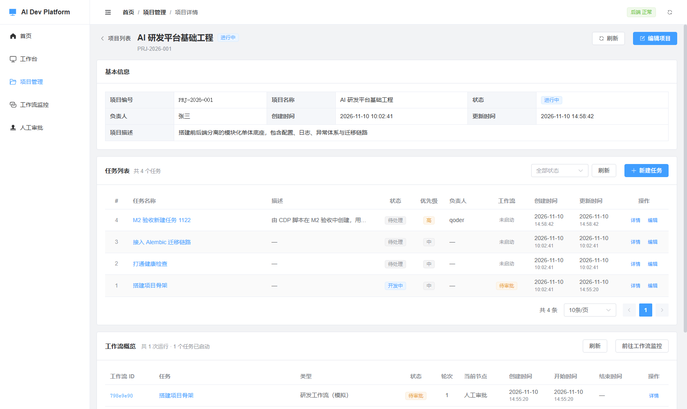

基本信息七项齐全；任务列表 4 条；「搭建项目骨架」已有一条待审批运行，任务表的「工作流」列与概览表一致；GitLab 卡片只有占位文字。面包屑「首页 / 项目管理 / 项目详情」，左侧菜单高亮「项目管理」。

页面加载发出的 API 请求（CDP `Network` 实录）：`GET /projects/{id}`、`GET /projects/{id}/tasks?page=1&page_size=10`、`GET /workflows?project_id=…&page=1&page_size=100`、`GET /tasks/{task_id}`（1 次，该任务不在当前任务页时用于解析名称）。

### 6.2 1440×900 适配

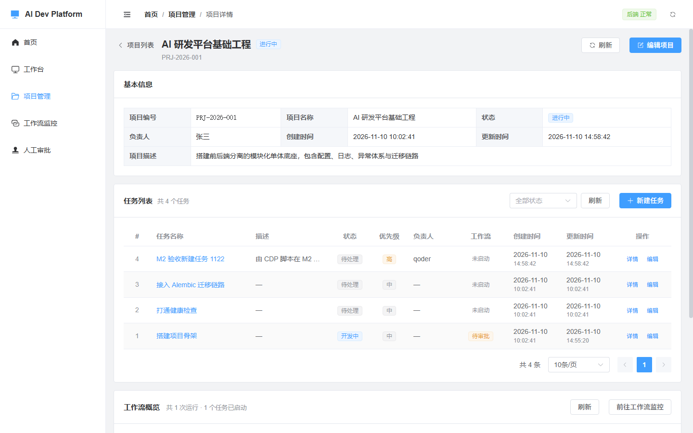

`docScrollWidth 1440 = clientWidth 1440`，`mainScrollWidth 1212 = clientWidth 1212`，无横向滚动。

### 6.3 任务状态筛选（URL `?task_status=in_progress`）

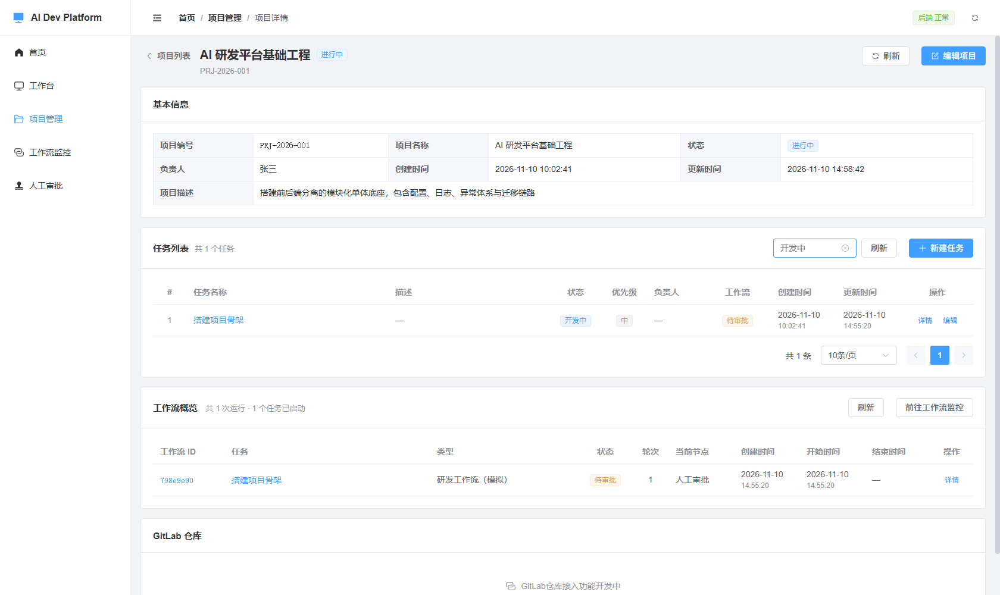

### 6.4 新建任务：校验 / 填写 / 成功

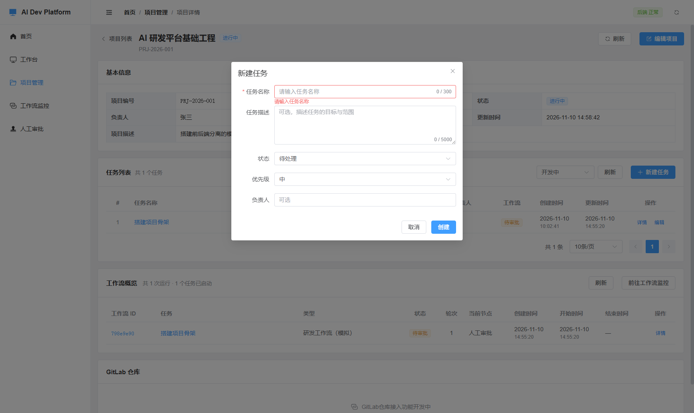
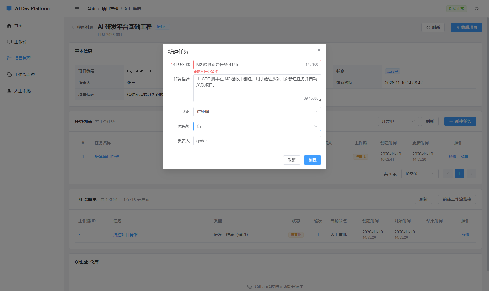
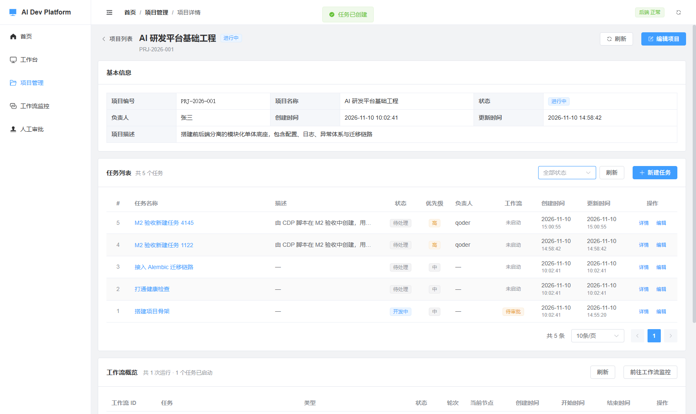

表单字段仅 任务名称 / 任务描述 / 状态 / 优先级 / 负责人。提交请求为 `POST /tasks`；后端查询确认 `project_id` 等于当前项目、`priority=high`、`assignee=qoder`。在筛选「开发中」状态下新建后，页面自动清除筛选并回到第 1 页，新任务出现在首行。

### 6.5 编辑任务


### 6.6 编辑项目（复用 M1 表单）

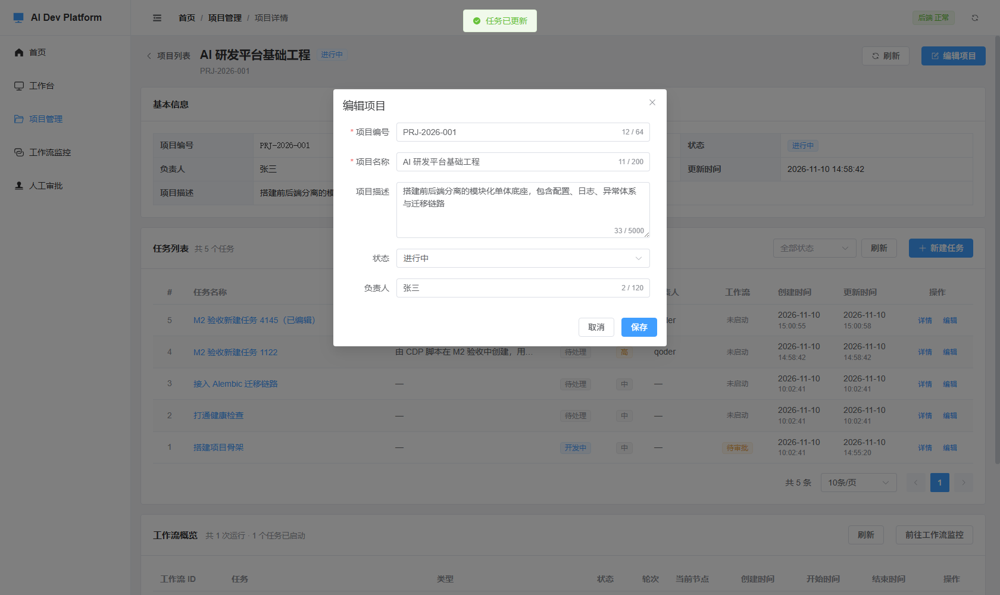


页头标题、基本信息与后端 `GET /projects/{id}` 返回值一致（`updated_at` 同步变化）。验收脚本随后通过 API 还原了项目名称与负责人。

### 6.7 刷新后恢复（`?task_status=pending&task_page_size=20`）

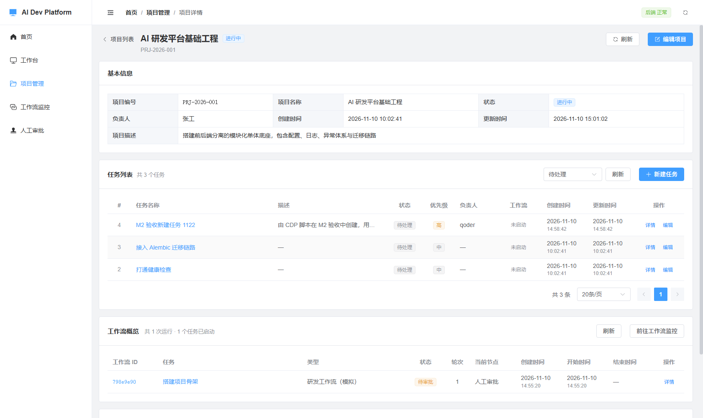

筛选框显示「待处理」，分页 20 条/页，3 行全部为待处理；数据均重新从后端加载。

### 6.8 项目不存在 / 已软删除

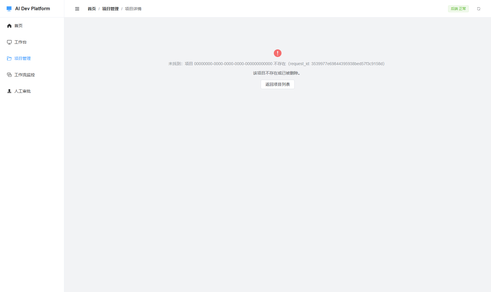
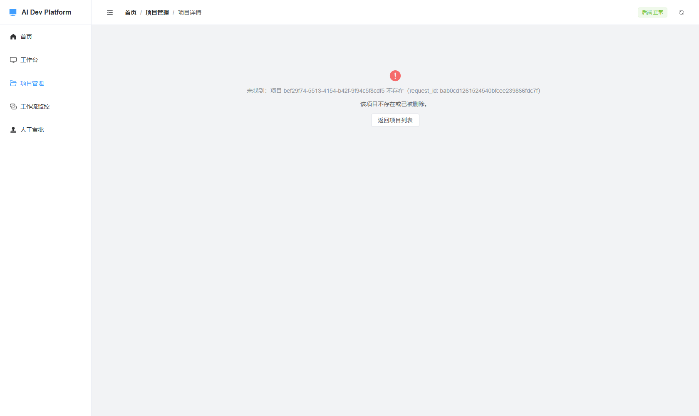

两种情况后端都返回 404；页面显示后端 message、`request_id`、提示「该项目不存在或已被删除」及「返回项目列表」，不弹重复 toast。

### 6.9 网络错误与子区块错误

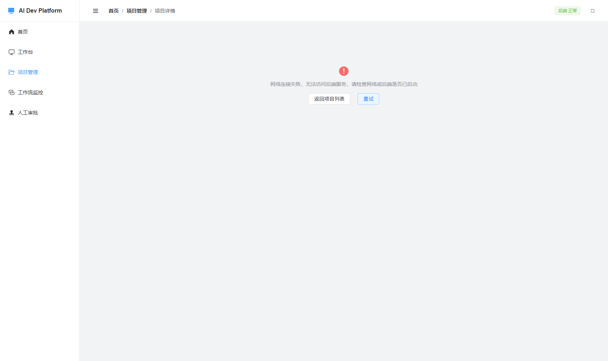
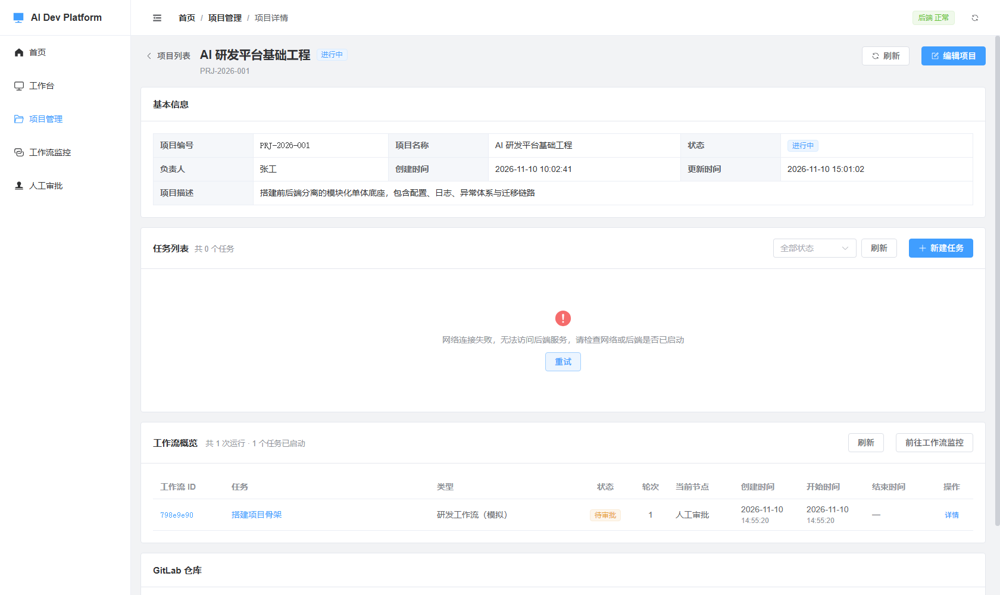

项目接口被浏览器侧断网后显示中文提示「网络连接失败，无法访问后端服务，请检查网络或后端是否已启动」+「重试」，恢复网络点击重试后页面正常。仅任务列表接口失败时，页头与工作流概览正常，任务卡片内单独显示错误与重试。

### 6.10 工作流概览 → 工作流详情

点击概览表「详情」跳转到 `/workflows/798e9e90-…`，面包屑「首页 / 工作流监控 / 工作流详情」，菜单高亮「工作流监控」（详情页内容在 M3 实现）。

## 7. 测试命令和真实测试结果

### 7.1 前端

```
$ npm run type-check
> vue-tsc --noEmit -p tsconfig.json && tsc --noEmit -p tsconfig.node.json
（无输出，退出码 0）

$ npm run build
✓ built in 13.70s
dist/assets/ProjectDetailView-B6HCaDb5.js  22.38 kB │ gzip: 7.26 kB
（仅有 Vite 既有的主包 >500 kB 提示，非错误）
```

`underline` 修正后再次执行 `npm run type-check`：通过（见第 7.3 节复验）。

### 7.2 后端

本阶段未改动后端代码，未重新执行 `pytest` / `ruff`；完整的后端回归放在任务 5 集成测试阶段统一执行。

### 7.3 浏览器端功能验收（CDP 驱动真实页面）

脚本：`%TEMP%\m1run\m2shots.mjs`，结果：`%TEMP%\m1run\m2shots.log`、`m2shots.json`。16 个步骤全部通过，浏览器 `console.error` 为 0，未捕获异常为 0。唯一的 `console.warn` 是 Element Plus 对 `:underline="false"` 的弃用提示，已修正。

### 7.4 未验证项

- 修正 `underline` 后未重新跑完整 CDP 脚本（改动仅是属性写法，不影响行为）；复验命令：`node %TEMP%\m1run\m2shots.mjs`。
- 任务列表翻页（第 2 页）未在浏览器中点击验证——验收项目最多 5 个任务，不足一页；分页逻辑与 M1 列表页一致，URL 参数 `task_page` 已在刷新恢复步骤验证。

## 8. 遗留问题

| 编号 | 说明 | 影响 | 建议 |
| --- | --- | --- | --- |
| M2-1 | 工作流概览的任务名称需前端解析（`WorkflowRead` 无名称字段） | 首屏最多为每个不在当前任务页的任务发 1 次 `GET /tasks/{id}`（有缓存与去重） | 任务 6 评估为 `WorkflowRead` 追加 `task_title` / `project_name`（新增字段，兼容） |
| M2-2 | 项目概览只取最近 100 次运行 | 超过 100 次时显示提示并引导到监控页 | 保持 |
| M2-3 | 验收过程在临时库中留下 2 个 `M2 验收新建任务` 与 1 个软删除项目 | 仅影响本机临时 SQLite 库 | 无需处理 |

## 9. 结论

M2 功能点全部完成，`type-check` 与 `build` 通过，浏览器端 16 步真实验收通过；未新增后端接口与迁移。可以进入 M3。
